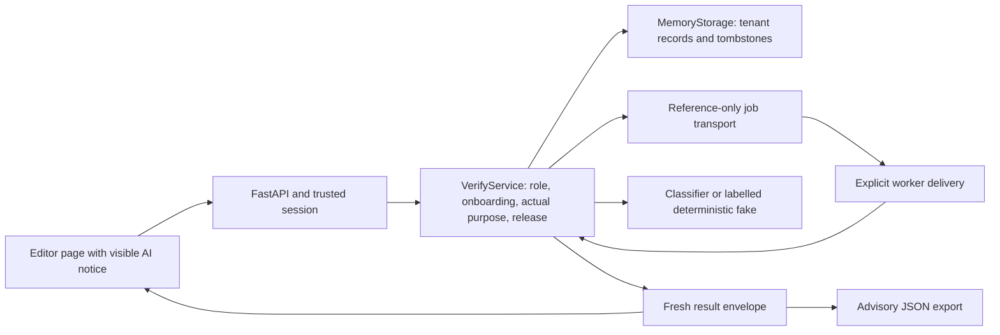

# Product architecture

The source provides a single-process vertical slice. `create_local_app` calls `build_service`, which injects a clock, classifier, storage, queue, trusted directory, onboarding records, registry, notices and audit sink. Importing modules creates neither the app nor SDK clients. The adapters implement `Classifier` and `JobTransport`; `MemoryStorage` implements the declared storage boundary.

`BodyLimit` bounds actual HTTP request bytes before parsing; Pydantic forbids unknown fields and validates shapes. `validate_use` rejects each unsupported requested purpose, incompatible domain or withdrawn model before writes or job delivery. Unsupported language returns an abstention without inference. `Directory.resolve` maps an opaque session token to a server-owned principal. Every service entry revalidates membership and role against the directory and requires a current role-specific participation record. Local sessions are freely selectable synthetic identities and are not production authentication.

`submit` validates an entire batch before any side effects, then assigns UUIDs and queues references. Idempotency is scoped to tenant, subject, operation and request key. A hash covers all ordered item fields. Identical repeats return the same submissions; changed requests under that scope return 409. Idempotency does not automatically retry a failed inference. A transport failure leaves an explicit failed submission; callers can request a bounded retry. SDK automatic retries are disabled; the service permits at most three attempts. Duplicate or obsolete job attempts do nothing.

`run_one` authorizes the internal operator. `process` checks current tenant membership, onboarding, stored purpose, model release and domain before looking in the cache. Cache keys contain tenant, model version, domain, language and SHA-256 input digest. Cache values contain only structured inference, without notices or historical UI messages. A release withdrawal blocks processing and subsequent result delivery; deletion remains available. Provider exceptions, malformed responses and version mismatches produce failed states with no guessed output.

Storage's reentrant lock spans inference, commit and deletion, serializing those actions in this intentionally small process. Deletion writes a tombstone first, removes the record, clears input/features/output/judgment and cache, strips affected idempotency fingerprints and cancels local queued/leased references. It retains only tenant/id tombstones and scoped key-to-id bindings so repeats cannot restore data. Deleting one record also evicts its shared cache entry; independent explicitly submitted duplicate records remain individually deletable. A held in-process record reference is cleared. Browser deletion clears the text field, pending request body and rendered advice. Sanitized audit events remain: timestamp, tenant, actor, action, random submission id and model version, never raw text, credentials, score or arbitrary exceptions. These residual identifiers are not claimed anonymous.

SQS carries only tenant/id/attempt references. It cannot recall unseen messages; `cancel` relies on the repository tombstone to invalidate them. Late references are acknowledged without inference. Physical message expiry and provider-side inference-data deletion cannot be established here. Nothing persists text across restarts. A new process has neither the payload nor a record for an old remote reference, so it ignores that reference; process-lifetime idempotency and tombstones are not a durable production retention system.

`result_envelope` combines analysis-time and current model limitations, the current notice and the notice version at submission. All reads, repeat submissions, retry/review responses and exports use this path. `editor.html` renders the notice before the disabled submission control; the external script enables submission after parsing. Direct review navigation and errors retain the same notice region. DOM content uses `textContent`, escaped Jinja fields and native labels/buttons. Accessibility needs human/browser verification; source inspection cannot certify it.

The repository contains no distributed worker runner or production identity provider. Remote adapters can be injected into the same single process for a separately authorized integration exercise; they are not a deployable distributed architecture. Durable transactions/tombstones, identity federation, real staff records, provider retention settings, incident operations and deployment security require separately reviewed implementations. No infrastructure or migrations are supplied.
