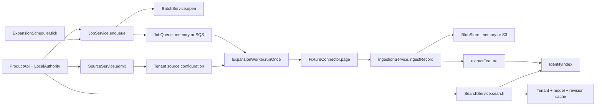

# Application architecture

`createProduct` is the composition root. `ProductApi` resolves trusted fixture principal IDs through `LocalAuthority`, then invokes application services. The facade accepts neither tenant claims nor role claims. Each service also checks its operation's role or resource ownership. This is an explicit in-process demo boundary, not deployable public authentication.

Source types are `direct_enrollment`, `public_web_bulk`, and `cctv_bulk`. Source metadata describes collection scope, acquisition method, a local fixture-set lineage, accessibility, recurrence, and status. The catalog contains no URLs to collect from. `FixtureConnector` only slices its injected, append-only records by availability time and an integer cursor. It rejects out-of-order availability so pagination remains stable as later fixtures appear.

`BatchService.open` binds a tenant idempotency key to a source and model. Reuse with different parameters fails. The batch freezes `snapshotAt`; retries see the same visible prefix. Each source/model pair has a checkpoint. Each batch retains processed input IDs so a successful item on an incomplete page is skipped on retry. Invalid synthetic items are recorded individually, and the worker continues. Content digests are tenant scoped. A repeated token yields no second record; a new model may add one version-specific feature to the existing record. A different key starts from the committed checkpoint. Permanent invalid records are consumed at the checkpoint and remain batch failures; correcting one requires a newly appended input record.

`JobService` persists a job before publishing its `{version,tenantId,jobId}` envelope. If publishing fails, retrying the same key republishes the queued job. Delivery is at least once. The worker validates envelopes, checks tenant ownership against authoritative state, and acknowledges unknown or terminal jobs. It serializes local commits with a process-wide busy flag. Transport acknowledgments may be retried by redelivery without duplicating indexed data. Retryable infrastructure failures get at most three job attempts; terminal failures become application `dead_letter` states. An invalid individual fixture makes a completed job's batch `partial`, not dead letter.

The ingestion commit adds the source-linked record, token digest, fabricated feature, and processed marker synchronously after blob persistence. Active-source and cancellation checks run before and after the awaited write. Feature IDs reference records and model versions; records reference source records and blobs; source configuration references the fixture set. Search returns that lineage with each candidate.

Direct submissions must have `enrolled=true`; bulk ingestion deliberately has no such restriction. `syntheticVector` hashes opaque tokens with a model-specific salt to generate eight fabricated values. `simulatedScore` ranks numerical proximity. There is no learned model, training pipeline, embedding endpoint, identity verification, or measured biometric accuracy. Both `synthetic-v1` and `synthetic-v2` are explicit model references with independent index views and cache keys.

Search validates the query and limit, filters tenant, model, source status, and record/feature expiration, ranks candidates, and records a minimal audit event. Cache keys include tenant, model, tenant index revision, query-token digest, and limit. Index mutations and suspension increment the revision. Cache lifetime is capped by the earliest selected record expiry. Results have no downstream consequential decision action.

`ExpansionScheduler.tick` sweeps retention, checks each active recurring source for the requested tenant/model, and enqueues a time-slot-idempotent job. A later tick can discover `web-003` or `cam-003`. Source suspension prevents new ingestion and suppresses existing source results. Job cancellation stops that job without undoing earlier committed records.

State, index, audit, and cache remain process-local even if infrastructure adapters are injected. The optional SQS adapter is only meaningful with one state-owning application process. A distributed or restart-durable product would require transactional state, an outbox, durable locks, and queue lease renewal; those are outside this small local slice. No such infrastructure has been created.
